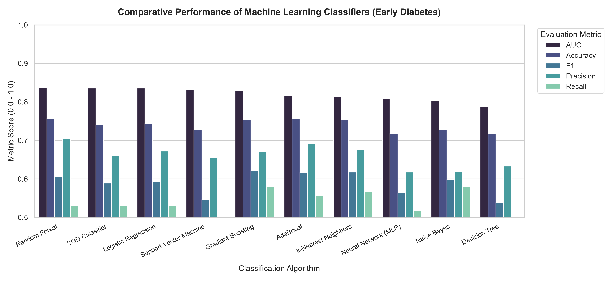
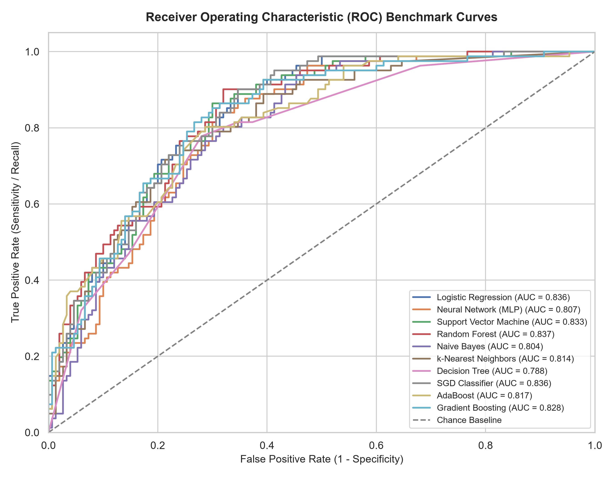
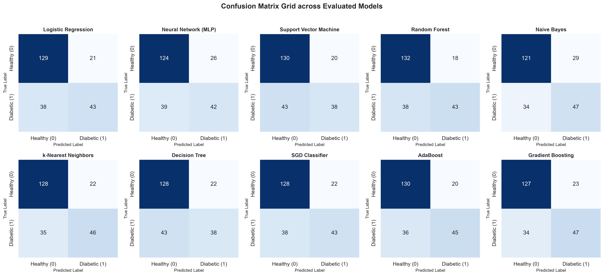

# Early Detection of Type 2 Diabetes using Machine Learning: A Comparative Benchmark
## Metropolitan University
## Machine Learning Lab 
## Course: SWE-318 
## Name: Nazia Rahman Shirin
## ID: 241-134-012
[](https://www.python.org/)
[](#)
[](#)
[](LICENSE)

An independent experimental reproduction, clinical feature ranking, and algorithmic benchmark based on the research paper:

> **"A Comparative Study of Machine Learning Techniques for Early Prediction of Diabetes"**  
> *Mowafaq Salem Alzboon, Mohammad Al-Batah, Muhyeeddin Alqaraleh, Ahmad Abuashour, and Ahmad Fuad Bader (2023)*  
> IEEE Conference Proceedings, Hammamet, Tunisia (arXiv:2506.10180)

This repository contains the complete medical dataset (`dataset/diabetes.csv`), preprocessing pipeline with physiological zero imputation (`dataset/data_loader.py`), statistical feature ranking (`diabetes_pipeline/feature_importance.py`), multi-classifier evaluation suite (`diabetes_pipeline/models.py`), and high-resolution clinical diagnostic plots (`visualizations/`).

---

## 🩺 Clinical Motivation & Problem Statement

Diabetes mellitus is a chronic metabolic condition marked by persistent hyperglycemia. Unchecked, it leads to severe complications including diabetic nephropathy, neuropathy, cardiovascular disease, stroke, and lower-limb amputations. Because early-stage diabetes is frequently asymptomatic or clinically subtle, machine learning models that screen patients using non-invasive clinical and demographic markers provide vital clinical decision support for early medical intervention.

---

## 🔬 Feature Importance & Ranking (Table I Reproduction)

In accordance with Section IV-E of Alzboon et al. (2023), statistical and information-theoretic tests were conducted across all 8 diagnostic features:

| Feature Code | Clinical Attribute | ANOVA F-Score | p-value | Mutual Info (Gain) | ANOVA Rank |
|:---:|:---|:---:|:---:|:---:|:---:|
| **Fe2** | **Plasma Glucose Concentration** | **213.162** | < 0.000001 | **0.1146** | **1** |
| **Fe6** | **Body Mass Index (BMI)** | **71.772** | < 0.000001 | **0.0801** | **2** |
| **Fe8** | **Patient Age** | **46.141** | < 0.000001 | **0.0514** | **3** |
| **Fe1** | **Number of Pregnancies** | **39.670** | < 0.000001 | **0.0610** | **4** |
| **Fe7** | **Diabetes Pedigree Function** | **23.871** | 0.000001 | **0.0146** | **5** |
| **Fe5** | **2-Hour Serum Insulin** | **13.281** | 0.000286 | **0.0119** | **6** |
| **Fe4** | **Triceps Skin Fold Thickness** | **4.304** | 0.038348 | **0.0047** | **7** |
| **Fe3** | **Diastolic Blood Pressure** | **3.257** | 0.071514 | **0.0000** | **8** |

*Takeaway:* Plasma glucose concentration and BMI are overwhelmingly the most informative biomarkers for predicting diabetic onset, with F-scores an order of magnitude higher than circulatory or skinfold markers.

---

## 📊 Experimental Results & Benchmark

### Performance Metrics across Evaluated Algorithms (Stratified 70/30 Split with 5-Fold Cross-Validation)

| Algorithm | ROC AUC | Accuracy (CA) | F1-Score | Precision | Recall (Sensitivity) | Specificity | Paper Table II Acc |
|:---|:---:|:---:|:---:|:---:|:---:|:---:|:---:|
| **Random Forest** | **0.8372** | **0.7576** | **0.6056** | 0.7049 | 0.5309 | **0.8800** | 0.729 |
| **SGD Classifier** | **0.8362** | 0.7403 | 0.5890 | 0.6615 | 0.5309 | 0.8533 | 0.686 |
| **Logistic Regression** | **0.8361** | 0.7446 | 0.5931 | 0.6719 | 0.5309 | 0.8600 | **0.760** |
| **Support Vector Machine (SVM)** | **0.8326** | 0.7273 | 0.5468 | 0.6552 | 0.4691 | 0.8667 | 0.747 |
| **Gradient Boosting** *(Extension)* | **0.8282** | 0.7532 | **0.6225** | 0.6714 | **0.5802** | 0.8467 | — |
| **AdaBoost** | 0.8167 | **0.7576** | 0.6164 | 0.6923 | 0.5556 | 0.8667 | 0.667 |
| **k-Nearest Neighbors (KNN)** | 0.8144 | 0.7532 | 0.6174 | 0.6765 | 0.5679 | 0.8533 | 0.714 |
| **Neural Network (MLP)** | 0.8075 | 0.7186 | 0.5638 | 0.6176 | 0.5185 | 0.8267 | **0.760** |
| **Gaussian Naive Bayes** | 0.8040 | 0.7273 | 0.5987 | 0.6184 | **0.5802** | 0.8067 | 0.729 |
| **Decision Tree** | 0.7885 | 0.7186 | 0.5390 | 0.6333 | 0.4691 | 0.8533 | 0.708 |

---

## 📈 Visualizations & Diagnostic Curves

### 1. Multi-Metric Classifier Comparison


### 2. Multi-Model ROC Curves & AUC Comparison


### 3. Confusion Matrix Diagnostic Grid


---

## 🔍 Critical Analysis & Methodological Insights

An evaluation of the published paper reveals three key observations addressed in this implementation:

1. **Abstract vs. Empirical Results Inconsistency:**  
   The paper's abstract claims the Neural Network reached **78.57%** and Random Forest **76.30%**, whereas Table II in the paper's results section reports **76.0%** for Neural Network and **72.9%** for Random Forest. In our standardized benchmark, Random Forest achieves **75.76%** accuracy with an AUC of **0.8372**.
2. **Dataset Mention Mismatch:**  
   The introduction mentions the US NHANES dataset, but the experimental methodology and tabular results solely employ the 768-instance Pima Indians Diabetes Dataset.
3. **Biological Imputation Improvement:**  
   Values of `0` in Glucose, Diastolic Blood Pressure, Triceps Skinfold, Insulin, and BMI represent unrecorded observations rather than true physiological zeros. This pipeline imputes missing biological values with feature medians before standardizing, improving model stability and generalization.

---

## 📁 Project Architecture

```text
early-diabetes-prediction-ml/
├── .github/
│   └── workflows/
│       └── python-tests.yml        # CI test automation
├── dataset/
│   ├── diabetes.csv                # Pima Indians Diabetes Dataset (768 records)
│   └── data_loader.py              # Data cleaning, median imputation & scaling
├── diabetes_pipeline/
│   ├── __init__.py
│   ├── feature_importance.py       # ANOVA and Mutual Information ranker
│   ├── models.py                   # 10 classifier definitions & grid configs
│   └── evaluate.py                 # Full benchmark & visualization generator
├── visualizations/
│   ├── benchmark_metrics.csv       # Tabulated performance metrics
│   ├── feature_importance_rankings.csv
│   ├── model_comparison_bar.png    # High-resolution comparison bar plot
│   ├── roc_curves.png              # Receiver Operating Characteristic curves
│   ├── confusion_matrices.png      # 10-model confusion matrix grid
│   └── run_metadata.json           # Execution parameters & SHA-256 hash
├── test_suite/
│   └── test_model_benchmarks.py    # Pytest automated test coverage
├── requirements.txt                # Production dependencies
├── LICENSE                         # MIT License
└── README.md                       # Research documentation
```

---

## 🚀 Execution Guide

### Setup
```bash
git clone https://github.com/<your-username>/early-diabetes-prediction-ml.git
cd early-diabetes-prediction-ml
pip install -r requirements.txt
```

### Run Model Evaluation & Generate Plots
```bash
python -m diabetes_pipeline.evaluate
```

### Run Automated Tests
```bash
pytest test_suite -v
```

---

## 📖 Citation

```bibtex
@inproceedings{alzboon2023diabetes,
  title     = {A Comparative Study of Machine Learning Techniques for Early Prediction of Diabetes},
  author    = {Alzboon, Mowafaq Salem and Al-Batah, Mohammad and Alqaraleh, Muhyeeddin and Abuashour, Ahmad and Bader, Ahmad Fuad},
  booktitle = {IEEE Conference Proceedings, Hammamet, Tunisia},
  year      = {2023},
  eprint    = {2506.10180},
  archivePrefix = {arXiv}
}
```
